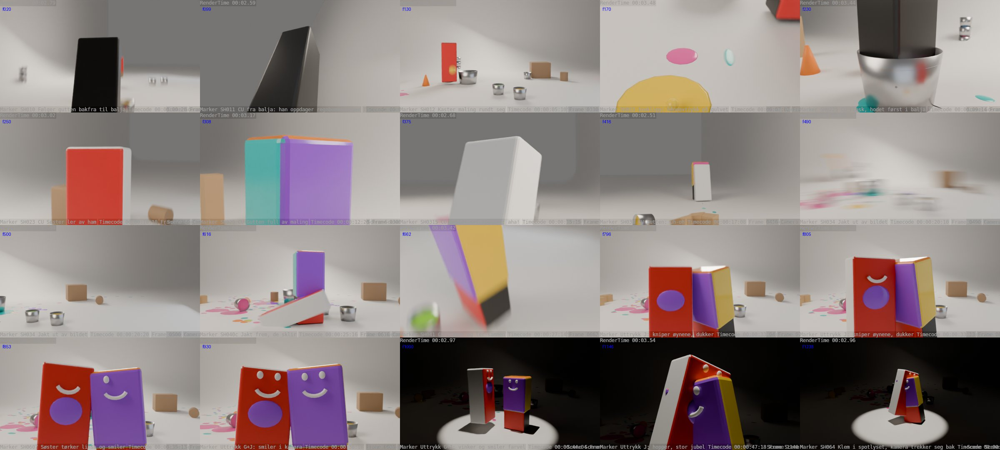

# Kylling-previs (Blender)

Blokking-previs av de to kyllingene i et hvitt, Pixar-aktig studio.
De erter hverandre og kaster maling på hverandre.



Preview-video i lav oppløsning (640×360, Cycles 4 samples): [`kylling_previs_preview.mp4`](kylling_previs_preview.mp4)

## Kjør

**I Blender (4.2+ / 5.x):** Scripting-fanen → *Open* → `kylling_previs.py` → *Run Script*.

**Fra terminal:**

```bash
blender -b -P kylling_previs.py -- --save kylling_previs.blend
```

`kylling_previs.blend` er ferdig bygget med Blender 5.2. Bruker du en eldre versjon, kjør heller skriptet.

Skriptet tømmer scenen og bygger alt på nytt hver gang det kjøres, så du kan endre tall og kjøre det igjen.

## Karakterene

| Blokk | Karakter | Kropp | Forside |
|------|----------|-------|---------|
| `Gutt` | Gul kylling i oransje snekkerbukse | svart | rød |
| `Jente` | Gul kylling i korall kjole med sløyfe | hvit | rød |

- Høy blokk på 0,7 × 0,5 × 1,7 m (bredde × dybde × høyde), så den leses som en person. Origo er i bunnen, så squash/stretch skjer fra gulvet. Mål endres i `CHAR_W`, `CHAR_D` og `CHAR_H` øverst i skriptet.
- Forsiden (lokal −Y) er rød, så du alltid ser hvilken vei de ser.
- Navneskilt over hodet vises bare i viewport, ikke i render.

## Studio

- Hvit cyclorama (gulvet bøyer seg opp i bakveggen), ingen synlig horisont.
- Tre-punkts område-lys: varm key, kjølig fill, rim bakfra.
- Rekvisitter: trekasse, en stor regnbuebalje midt på gulvet (én kile i hver farge), et gult og et rosa malingsspann.
- Rommet blir gradvis mer malt. Det kommer flekker rundt hvert søl (kast, balja, risting, treff, tårnet, skliingen), og fargede fotavtrykk etter dem når de løper. Gutten drypper turkis og lilla etter dukkingen, og søster tråkker rosa. Dette lages i `build_paint_marks()`.
- Malingen er i lyse, lekne farger: rosa, turkis, gul, lime, lilla, oransje og himmelblå. Hvert kast har sin egen farge, håndavtrykkene går i regnbuerekkefølge, og gutten blir dekket av flere farger når han dukkes i balja.

## Handling (24 fps, 1238 frames ≈ 52 sek)

| Frames | Del | Hva skjer |
|--------|-----|-----------|
| 1–203 | Åpning | Et følgeskudd bakfra følger gutten (svart) mens han løper inn og velter en malingsboks på veien til balja. Nærbilde fra balja: han titter ned i regnbuemalingen og jubler. Han kaster maling rundt seg (total), og et innklipp viser håndavtrykkene på gulvet. |
| 204–317 | Søster kommer | Søster (hvit) løper inn og sparker ham (f222). Han tar salto, og et lavt nærbilde viser plasket når han havner med hodet først i balja (f238). Hun ler, og han spretter opp full av maling og rister seg som en hund, og blir stående dryppende og stirre på henne. |
| 318–521 | Malingskamp | Gutten kaster på henne (treff f338). Hun blir sint, ser spannet (nærbilde «aha!»), kaster og bommer, og jager ham. Totalen blir stående mens begge løper ut av bildet til venstre. Så panorerer kameraet raskt til høyre (f487–493), og de kommer løpende inn igjen fra høyre, hun først og han etter. |
| 522–725 | Jakten dypt i rommet | De løper dypt inn i rommet. Hun raser forbi kameraet og river ned tårnet. Begge sklir i den store gule malingsdammen med beina til værs og malingssprut, og de ligger og ler hode mot hode, så kommer en piruett og et dunk. Til slutt erter hun ham. |
| 726–1238 | Slutten | Hun løper mot kamera og dukker, og malingen hans treffer linsa (f796). Nærbilde av gutten: «oi!», og han fniser. Hun tørker linsa (f822–832) og smiler. Han kommer og klemmer henne (f906). Det blir mørkt med et spotlys ovenfra (f1026–1044), og de vinker. Hun hopper opp og klemmer broren (nærbilde, f1146), og kameraet trekker seg bak i spotlyset. Slutt. |

**Pusterom.** Åtte korte pauser på 0,5–0,8 sekunder gir tid til reaksjonene, og figurene puster mens de står:
1. Han ser ned i regnbuemalingen.
2. Han beundrer verket sitt.
3. Han står dryppende og stirrer på henne.
4. Hun får øye på spannet.
5. «Uh-oh», han fryser.
6. De puster ut etter latteren.
7. Hun puster lettet ut etter linsa.
8. Hun ser på broren før hoppeklemmen.

Siste bilde står i ett sekund før det er slutt.

### Ting som veltes

Sju ting står plassert langs løpeveiene og veltes når figurene løper forbi. Malingsboksene søler maling på gulvet når de velter.

| Frame | Hvem | Hva |
|-------|------|-----|
| 31 | Gutten løper inn | Gul malingsboks velter og søler |
| 203 | Søster løper inn | Krakk velter |
| 433 | Gutten flykter | Kjegle velter |
| 443 | Gutten flykter | Eskestabel flyr |
| 550 | Søster dypt i rommet | Tårn av malingsbokser (rosa, blå, lime) raser og søler |
| 743 | Gutten jager henne | Lime malingsboks velter og søler |
| 763 | Søster løper mot kamera | Krakk velter |

Avslutningen med mørke, spotlys, kameraet som trekker seg bak, vinkingen og hoppeklemmen lages i `build_finale()`.

Tingene lages i `build_knockables()`. `knock_over()` velter én ting, og `scatter()` sender en stabel flyvende.

### Shotliste

| Frame | Kamera | Shot |
|-------|--------|------|
| 1 | `CAM_00_Tracking` | SH010 Følger gutten bakfra til balja |
| 76 | `CAM_CU_09_Fra_Balja` | SH011 CU fra balja: han oppdager regnbuemalingen |
| 118 | `CAM_01_Wide` | SH012 Kaster maling rundt seg |
| 160 | `CAM_CU_10_Handavtrykk` | SH013 Innklipp: håndavtrykk på gulvet |
| 176 | `CAM_01_Wide` | SH014 Beundrer verket sitt |
| 204 | `CAM_02_Medium` | SH020 Søster kommer |
| 214 | `CAM_CU_01_Gutt_OTS` | SH021 CU Gutten ser henne (OTS) |
| 220 | `CAM_02_Medium` | SH022 Spark, hodet ned i balja |
| 230 | `CAM_CU_11_Plask` | SH0225 CU Plask, hodet først i balja |
| 244 | `CAM_CU_02_Jente_Ler` | SH023 CU Søster ler av ham |
| 264 | `CAM_02_Medium` | SH024 Han spretter opp |
| 280 | `CAM_CU_03_Gutt` | SH025 CU Gutten full av maling |
| 318 | `CAM_01_Wide` | SH030 Han kaster tilbake |
| 335 | `CAM_CU_04_Jente_Treff` | SH031 CU Søster blir truffet, sint |
| 366 | `CAM_CU_12_Aha` | SH0315 CU Søster ser spannet: aha! |
| 390 | `CAM_01_Wide` | SH032 Hun henter spann |
| 404 | `CAM_CU_03_Gutt` | SH033 CU Gutten: uh-oh |
| 428 | `CAM_01_Wide` | SH034 Jakt ut av bildet |
| 522 | `CAM_03_Dyp` | SH040 Jakt dypt i rommet |
| 538 | `CAM_CU_08_Loep` | SH040b CU Søster raser forbi og river ned tårnet, han etter |
| 574 | `CAM_03_Dyp` | SH040c Jakt frem, de sklir |
| 632 | `CAM_CU_05_Liggende` | SH041 CU Ligger og ler sammen |
| 672 | `CAM_03_Dyp` | SH042 Piruett og dunk |
| 714 | `CAM_CU_06_Erting_OTS` | SH043 CU Søster erter ham (OTS) |
| 726 | `CAM_04_Ende` | SH060 Jakt mot kamera, maling på linsa |
| 806 | `CAM_CU_13_Oi` | SH0605 CU Gutten: oi! fniser |
| 820 | `CAM_04_Ende` | SH0607 Søster tørker linsa og smiler |
| 940 | `CAM_CU_07_Klem` | SH061 CU Klem, fniser til hverandre |
| 982 | `CAM_04_Ende` | SH062 Varmt smil i kamera, mørkt, spot, de vinker |
| 1122 | `CAM_CU_14_Hoppeklem` | SH063 CU Hoppeklem |
| 1174 | `CAM_04_Ende` | SH064 Klem i spotlyset, kamera trekker seg bak |

Ingen skudd er lenger enn ca. 6 sekunder.

Over-skulder-bildene (OTS) har den andre figuren i forgrunnen, så relasjonen mellom dem er med i bildet.

### Pixar-kamera og look

Dette gjør `build_cinematic()`:
- **Følger hodene:** alle kameraer unntatt sluttkameraet har *Track To* mot et fokuspunkt i hodehøyde, `Fokus_Gutt`, `Fokus_Jente` eller `Fokus_Midt` mellom dem. Bildet panorerer mykt etter figurene og følger hodet også i salto og når de ligger.
- **Følgeskudd i åpningen:** `CAM_00_Tracking` henger etter gutten bakfra (Copy Location med offset) og sikter på hodet hans.
- **Wide panorerer etter handlingen:** først etter gutten, og etter begge når søster kommer inn. Det står i øyehøyde (1,7 m) i stedet for ovenfra, og det brukes der handlingen trenger oversikt.
- **Sakte innkjøringer:** hvert skudd skyver sakte innover, 0,15–1,2 m i løpet av skuddet.
- **Dybdeskarphet:** nærbilder på f/2.0 og løpe-nærbildet på f/2.8. Medium, dyp og sluttkameraet bruker f/4, og wide f/5.6. Fokus følger alltid hodene.
- **Bevegelsesuskarphet:** slått på for alle skudd.
- **Fargelook:** AgX med *Punchy*, for fyldigere og mer mettede farger.
- **Lys:** varmere key, kjøligere fill og sterkere varmt rimlys, så figurene skiller seg fra bakgrunnen.

Kamerabyttene ligger som markører på tidslinja, bundet til kameraene, så *Viewport Render Animation* og vanlig render klipper automatisk.

I tillegg ligger det markører som heter `Uttrykk …` (uten kamera). De angir hvilket ansiktsuttrykk figurene skal ha i den ferdige versjonen, for eksempel «ertende», «skrekkslagen», «lettet», «stort smil», «klem, latter» og «varmt smil i kamera». Hvert uttrykk har 1–3 sekunder å virke på.

## Justere

- **Timing:** `animate_boy()` og `animate_girl()` er lister med `P(frame, x, y, z, len_frem, retning, squash)`. Løping lages med `run(figur, start, slutt, [(x, y), ...])` langs en rute.
  - `len_frem > 0` lener forsiden frem, `< 0` lener bakover.
  - `retning`: 90 = ser mot høyre, −90 = mot venstre, 0 = mot kamera.
  - `squash < 1` gir squash, `> 1` gir stretch.
  - `raw=True` bruker vinkelen udempet (salto, ligge på ryggen). `spin=True` gir hele piruetter.
- **Tempo:** `CUTS` i skriptet er en liste over tidsbiter som klippes ut. Alt etter et klipp flyttes frem automatisk, så du kan stramme eller løsne tempoet uten å flytte hver keyframe for hånd. Frame-tallene i animasjonskoden er de opprinnelige tallene, før klippene.
- **Pusterom:** `HOLDS` i skriptet er en liste over pauser `(frame, lengde)` som legges inn etter klippene. Alt står stille og figurene puster litt, mens sprut som er i lufta får fly ferdig. `END_HOLD` lar siste bilde stå litt før slutt.
- **Maling:** `build_paint_fx()` styrer klatter, dammer, håndavtrykk, malingsdrakten og malingen på linsa.
- **Farger:** konstantene øverst (`RED`, `BLACK`, `WHITE`) og malingsfargene i `PAINTS`. Hvilken farge hvert kast, hver dam og hver flekk har, settes i `build_paint_fx()`.
- **Render:** EEVEE, 1920×1080 på 50 %, AgX, med stempel for shotnavn og kamera. For rask playblast bruker du *View → Viewport Render Animation*.

## Til AI-look

Render en shot med EEVEE eller viewport-render, og bruk de to referansebildene som stil-/karakter-referanse i AI-verktøyet.
Gutten er den svarte blokken og jenta den hvite. Den røde forsiden og blokkens retning viser hvor hodet og blikket skal peke.
